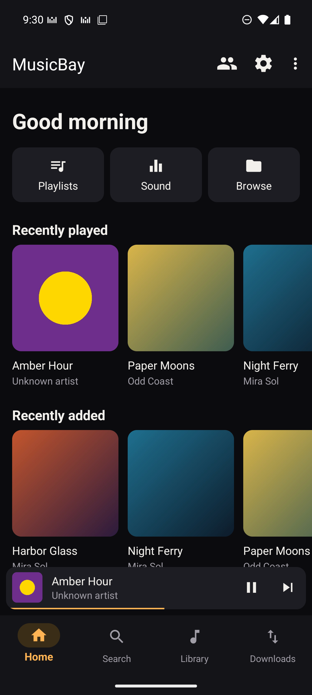
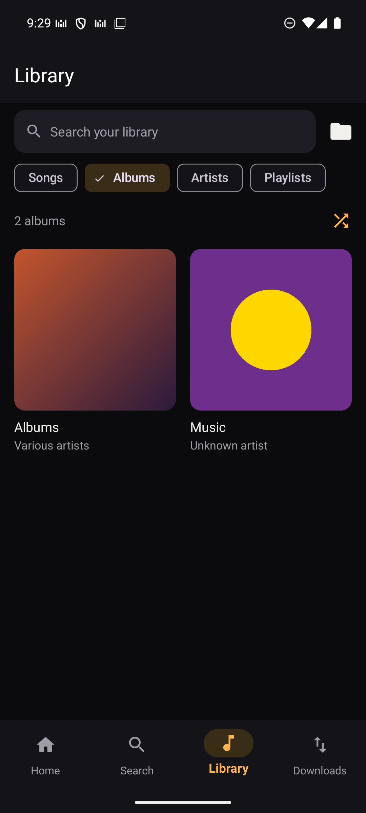
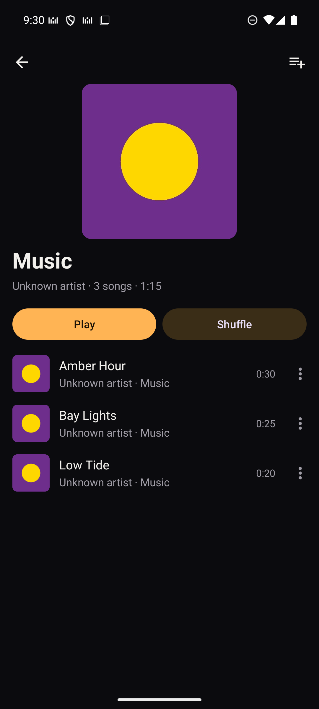
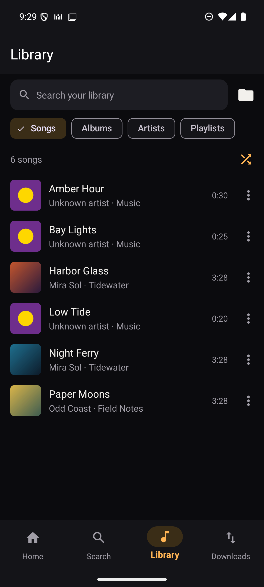
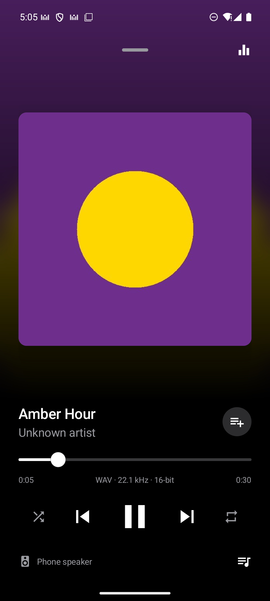
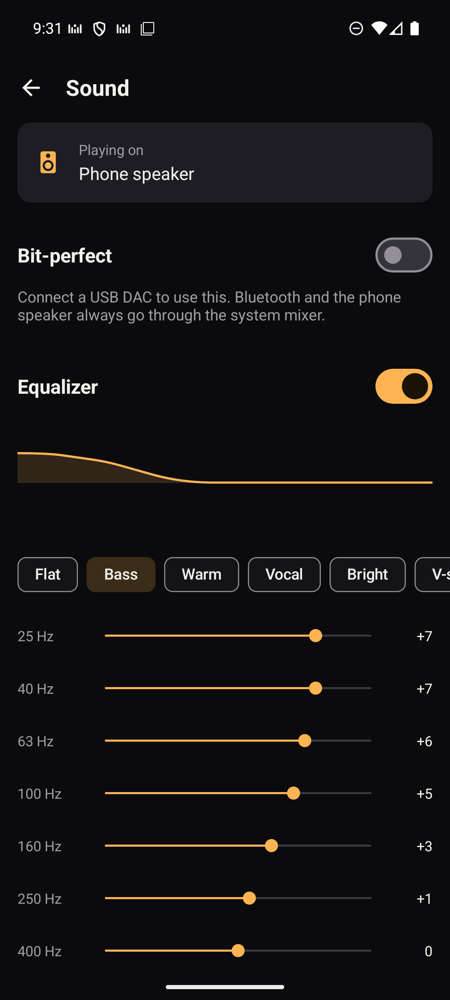
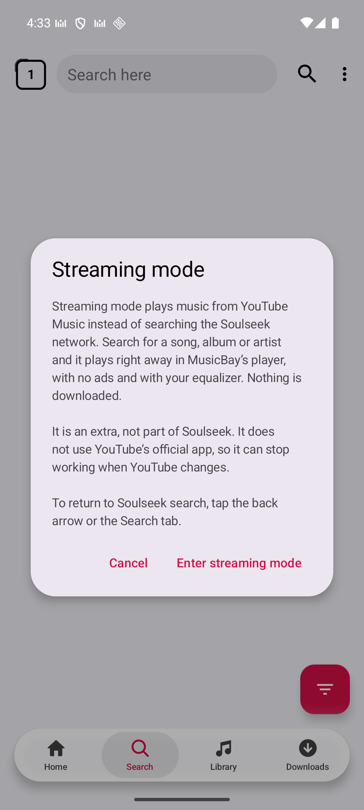
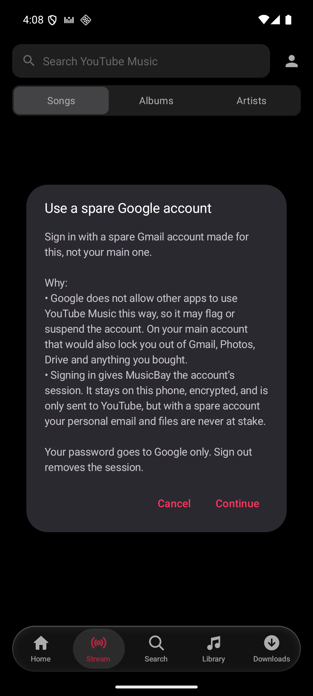
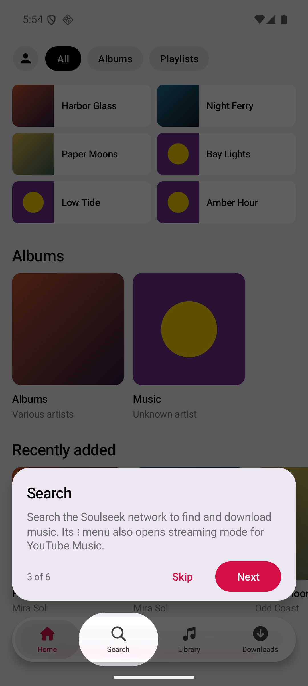

<h1>MusicBay</h1>

<strong>A free, open source music player and Soulseek client for Android.</strong>

  
  
  

  <a href="#features">Features</a> &nbsp;&middot;&nbsp;
  <a href="#screenshots">Screenshots</a> &nbsp;&middot;&nbsp;
  <a href="#build-from-source">Build</a> &nbsp;&middot;&nbsp;
  <a href="#contributing">Contributing</a> &nbsp;&middot;&nbsp;
  <a href="#credits">Credits</a> &nbsp;&middot;&nbsp;
  <a href="#license">License</a>

  MusicBay brings your local music library and Soulseek discovery together in one app, with a clean, iOS-style design
  in light and dark. It has no ads, no account requirement for local playback, and no paid features. An optional
  streaming mode plays music from YouTube Music through the same player.

<blockquote>
  

    <strong>Project status:</strong> MusicBay is an early preview. Download the latest APK from <a href="https://github.com/ssenwako/MusicBay/releases/latest">Releases</a>, for 64-bit Android phones. The app offers new versions when it opens.
  

</blockquote>

<h2 id="features">Features</h2>

<h3>Music player</h3>

<table>
  <tr>
    <th align="left" width="180">Feature</th>
    <th align="left">What it does</th>
  </tr>
  <tr>
    <td><strong>Home</strong></td>
    <td>Recently played songs, recently added music, albums, and playlists, each one tap away.</td>
  </tr>
  <tr>
    <td><strong>Library</strong></td>
    <td>Browse by songs A&ndash;Z, albums, artists, and playlists. Search across all of them, with accents ignored. Choose which folders appear.</td>
  </tr>
  <tr>
    <td><strong>Albums and covers</strong></td>
    <td>Each music folder is an album. An image such as <code>cover.jpg</code> or <code>folder.jpg</code> becomes its cover, with embedded artwork as the fallback.</td>
  </tr>
  <tr>
    <td><strong>Playlists and queue</strong></td>
    <td>Create, rename, reorder, and delete playlists. Add a song or a whole album, or use Play next and Add to queue.</td>
  </tr>
  <tr>
    <td><strong>Now Playing</strong></td>
    <td>Shows the file format, such as FLAC &middot; 44.1 kHz &middot; 16-bit, with a background tinted by the artwork. Controls also appear on the lock screen and respond to headset buttons.</td>
  </tr>
  <tr>
    <td><strong>Audio output</strong></td>
    <td>Shows where sound is going: phone speaker, wired, USB, or the name of the Bluetooth device. Playback pauses when headphones disconnect.</td>
  </tr>
  <tr>
    <td><strong>Equalizer</strong></td>
    <td>15 bands from 25 Hz to 16 kHz, &plusmn;15 dB, with a preamp and twelve presets. Boosts lower the overall level instead of clipping. Requires Android 9 or newer.</td>
  </tr>
  <tr>
    <td><strong>Bit-perfect</strong></td>
    <td>Sends audio to a USB DAC with no mixing or resampling on Android 14 or newer. Files up to 16-bit only for now. Bluetooth and the phone speaker always use the system mixer.</td>
  </tr>
</table>

<h3>Soulseek</h3>

<table>
  <tr>
    <th align="left" width="180">Feature</th>
    <th align="left">What it does</th>
  </tr>
  <tr>
    <td><strong>Search and download</strong></td>
    <td>Search the Soulseek network with filters and a wishlist, and download songs or whole folders.</td>
  </tr>
  <tr>
    <td><strong>Community</strong></td>
    <td>Share your music, browse other users, send messages, and join chatrooms. Port forwarding is set up for you where the router allows it.</td>
  </tr>
</table>

<h3>Streaming mode (extra)</h3>

<table>
  <tr>
    <th align="left" width="180">Feature</th>
    <th align="left">What it does</th>
  </tr>
  <tr>
    <td><strong>Where to find it</strong></td>
    <td>Open the &#8942; menu on the Search tab and choose <em>Enter streaming mode</em>. It stays on while you switch tabs; the back arrow returns to Soulseek search.</td>
  </tr>
  <tr>
    <td><strong>Listen</strong></td>
    <td>Search YouTube Music for songs and albums, open album and artist pages, and play through MusicBay's own player: no ads, with the equalizer, and with the screen off. Nothing is downloaded.</td>
  </tr>
  <tr>
    <td><strong>Start screen</strong></td>
    <td>Before a search it reads like Home: recently played, albums you opened, and your playlists. A search shows albums and songs together, or albums only.</td>
  </tr>
  <tr>
    <td><strong>Sign-in (optional)</strong></td>
    <td>Sign in to see your YouTube Music playlists and Liked Music. Use a spare Google account, not your main one: Google does not allow third-party apps to use YouTube Music this way and may suspend the account. The app warns about this before every sign-in. The session is stored encrypted on the phone, and Sign out removes it.</td>
  </tr>
</table>

<h3>App</h3>

<table>
  <tr>
    <th align="left" width="180">Feature</th>
    <th align="left">What it does</th>
  </tr>
  <tr>
    <td><strong>First-run tour</strong></td>
    <td>On a new install, a short walkthrough lights up each part of the app in turn: Home, Search, Library, Downloads, and Account. People who update from an older version don't see it.</td>
  </tr>
  <tr>
    <td><strong>Updates</strong></td>
    <td>When a new version is out, the app offers it on launch with a list of what changed. You choose Update or Later, and Android asks before installing.</td>
  </tr>
  <tr>
    <td><strong>Design</strong></td>
    <td>Light and dark themes, translucent glass bars, and a single accent color.</td>
  </tr>
</table>

<h2 id="screenshots">Screenshots</h2>

<table>
  <tr>
    <td align="center" width="33%"> Home</td>
    <td align="center" width="33%"> Albums</td>
    <td align="center" width="33%"> Album</td>
  </tr>
  <tr>
    <td align="center"> Songs</td>
    <td align="center"> Now Playing</td>
    <td align="center"> Sound</td>
  </tr>
  <tr>
    <td align="center"> Streaming mode</td>
    <td align="center"> Spare-account warning</td>
    <td align="center"> First-run tour</td>
  </tr>
</table>

<h2 id="build-from-source">Build from source</h2>

<h3>Requirements</h3>

<ul>
  <li><a href="https://dotnet.microsoft.com/download/dotnet/10.0">.NET 10 SDK</a> with the Android workload</li>
  <li>Android SDK with API level 36</li>
  <li>JDK 17 or newer</li>
</ul>

<h3>Steps</h3>

<pre><code>git clone https://github.com/ssenwako/MusicBay.git
cd MusicBay
dotnet workload restore Seeker/Seeker.csproj

dotnet build Seeker/Seeker.csproj -c Release -f net10.0-android36.0 -t:SignAndroidPackage \
  -p:AndroidPackageFormat=apk -p:AndroidKeyStore=false \
  -p:RuntimeIdentifier=android-arm64 -p:RuntimeIdentifiers=android-arm64</code></pre>

  The APK is written to <code>Seeker/bin/Release/net10.0-android36.0/android-arm64/app.musicbay-Signed.apk</code>.
  It is signed with a debug key, so use it for testing only.

  To work without a Soulseek account, build with <code>-c "Debug Mock"</code>. This configuration uses a simulated
  Soulseek server and adds no real network traffic. See <a href="DEVELOPMENT.md">DEVELOPMENT.md</a> for more.

<h2 id="contributing">Contributing</h2>

  Contributions go through pull requests. Read <a href="CONTRIBUTING.md">CONTRIBUTING.md</a> first: it covers the
  workflow that avoids conflicts, how to build and test, and the license rules. If you use an AI assistant, point it
  at <a href="AGENTS.md">AGENTS.md</a>.

<h2 id="credits">Credits</h2>

MusicBay is built on the work of these projects:

<ul>
  <li>
    <a href="https://github.com/jackBonadies/SeekerAndroid">Seeker</a> by Jack Bonadies, the Soulseek client for Android
    that MusicBay is based on. MusicBay is not an official Seeker release.
  </li>
  <li>
    A modified version of the <a href="https://github.com/jpdillingham/Soulseek.NET">Soulseek.NET</a> library, used for
    communicating with the Soulseek server and network peers.
  </li>
  <li>
    The unofficial <a href="https://nicotine-plus.github.io/nicotine-plus/doc/SLSKPROTOCOL.html">Soulseek Protocol Documentation</a>
    by the developers of the <a href="https://github.com/nicotine-plus/nicotine-plus">Nicotine+</a> client.
  </li>
  <li>
    <a href="https://github.com/Tyrrrz/YoutubeExplode">YoutubeExplode</a> by Oleksii Holub (LGPL-3.0), used to find the
    audio streams for songs from YouTube Music.
  </li>
</ul>

  The Soulseek server, which makes the network possible, relies on donations.
  You can <a href="https://www.slsknet.org/donate.php">donate here</a>.

<h2 id="notice">Notice</h2>

This is a modified version of Soulseek.NET.  It is not maintained by, endorsed by, or affiliated with the Soulseek.NET project or its author(s).

  MusicBay is a modified version of Seeker. It is not maintained by, endorsed by, or affiliated with the Seeker project or
  its author. You are responsible for following the law and the rules of the Soulseek network when you use it.

  MusicBay is not affiliated with, endorsed by, or connected to YouTube or Google. Streaming from YouTube Music does not
  go through YouTube's official app, so it can stop working whenever YouTube changes its service.

<h2 id="license">License</h2>

  MusicBay is licensed under the <a href="LICENSE">GNU General Public License v3.0 only</a> (<code>GPL-3.0-only</code>),
  with Additional Terms pursuant to Section 7 of the GPLv3.

